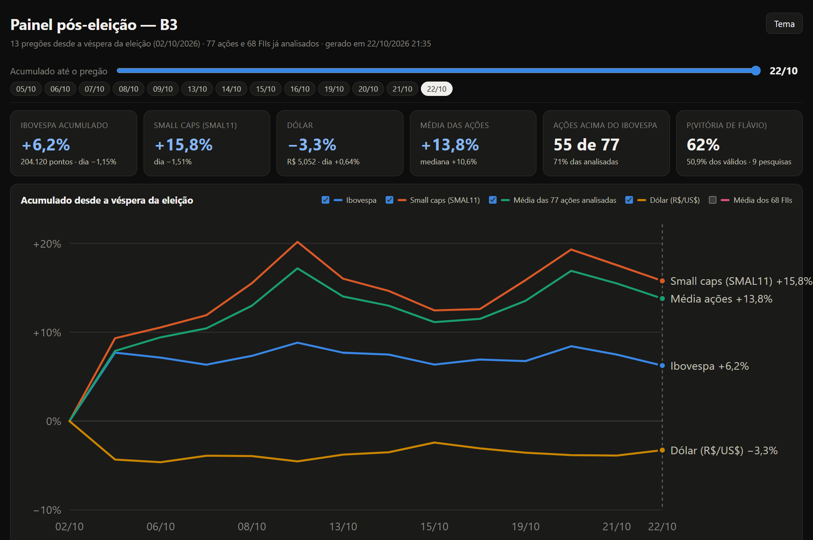

# Dividendos, FIIs e eleição 2026 na B3 — score determinístico + Jev

[](https://htmlpreview.github.io/?https://github.com/novaeslucas/b3/blob/main/resultados/dashboard_pos_eleicao.html)

<sub>Painel pós-eleição — clique na imagem para abrir o dashboard interativo.</sub>

Análise da qualidade dos dividendos de ações e dos rendimentos de fundos imobiliários (FIIs) listados na B3, seguida
de um acompanhamento diário do mercado entre o 1º turno (04/10/2026) e o 2º turno (25/10/2026) da eleição
presidencial.

A ideia central é **separar o que é conta do que é julgamento**:

- tudo que é cálculo (filtros, indicadores, score de 0 a 100, variações de preço, probabilidade a partir das
  pesquisas) é feito em Python, com pesos e limites explícitos no código;
- o que exige leitura qualitativa — “esse dividendo é sustentável?”, “esse DY está inflado?”, “essa empresa depende
  do governo federal?” — é perguntado ao **Jev**, um modelo da TypeSafe que recebe o estado já calculado e devolve
  julgamentos tipados com probabilidades;
- a decisão final (`estudar` / `monitorar` / `descartar`) é uma regra escrita no código que combina as duas coisas.

O Jev não calcula nada e não vê preço-alvo: ele classifica a partir dos números que o código lhe entrega.

> ⚠️ **Não é recomendação de investimento.** É um estudo de metodologia com dados públicos, que podem conter erros.

## Dashboards

Os dashboards são HTML estáticos; os links abaixo abrem cada um renderizado pelo htmlpreview.

**[Página inicial com todos os dashboards](https://htmlpreview.github.io/?https://github.com/novaeslucas/b3/blob/main/index.html)**

| Dashboard | Conteúdo |
|---|---|
| [Painel pós-eleição](https://htmlpreview.github.io/?https://github.com/novaeslucas/b3/blob/main/resultados/dashboard_pos_eleicao.html) | Acumulado de 02/10 a 29/10 por ativo, setor e fator eleitoral |
| [BESST no fechamento de 26/10](https://htmlpreview.github.io/?https://github.com/novaeslucas/b3/blob/main/resultados/painel_besst_2026_10_26.html) | Bancos, energia, saneamento, seguros e telecom no 1º pregão após o 2º turno (`python painel_besst.py --finalizado`) |
| [Ações — dividendos](https://htmlpreview.github.io/?https://github.com/novaeslucas/b3/blob/main/resultados/dashboard.html) | Nova análise com o fechamento de 26/10 (pós-2º turno): score + classificação do Jev |
| [Ações — dividendos (05/10)](https://htmlpreview.github.io/?https://github.com/novaeslucas/b3/blob/main/resultados/snapshot_2026_10_05/dashboard.html) | Snapshot de 05/10, base das leituras diárias |
| [FIIs — rendimentos](https://htmlpreview.github.io/?https://github.com/novaeslucas/b3/blob/main/resultados/dashboard_fiis.html) | Snapshot de 05/10: score, tipo do fundo e classificação do Jev |
| [Leitura pós-1º turno (05/10)](https://htmlpreview.github.io/?https://github.com/novaeslucas/b3/blob/main/resultados/dashboard_eleicao.html) | Primeiro pregão após o 1º turno × fatores eleitorais |
| [Ações com setores da B3 (06/10)](https://htmlpreview.github.io/?https://github.com/novaeslucas/b3/blob/main/leituras/2026_10_06/dashboard.html) | Reexecução com a classificação setorial oficial da B3 |

**Leituras diárias:** [06/10](https://htmlpreview.github.io/?https://github.com/novaeslucas/b3/blob/main/leituras/2026_10_06/dashboard_eleicao.html) · [07/10](https://htmlpreview.github.io/?https://github.com/novaeslucas/b3/blob/main/leituras/2026_10_07/dashboard_eleicao.html) · [08/10](https://htmlpreview.github.io/?https://github.com/novaeslucas/b3/blob/main/leituras/2026_10_08/dashboard_eleicao.html) · [09/10](https://htmlpreview.github.io/?https://github.com/novaeslucas/b3/blob/main/leituras/2026_10_09/dashboard_eleicao.html) · [13/10](https://htmlpreview.github.io/?https://github.com/novaeslucas/b3/blob/main/leituras/2026_10_13/dashboard_eleicao.html) · [14/10](https://htmlpreview.github.io/?https://github.com/novaeslucas/b3/blob/main/leituras/2026_10_14/dashboard_eleicao.html) · [15/10](https://htmlpreview.github.io/?https://github.com/novaeslucas/b3/blob/main/leituras/2026_10_15/dashboard_eleicao.html) · [16/10](https://htmlpreview.github.io/?https://github.com/novaeslucas/b3/blob/main/leituras/2026_10_16/dashboard_eleicao.html) · [19/10](https://htmlpreview.github.io/?https://github.com/novaeslucas/b3/blob/main/leituras/2026_10_19/dashboard_eleicao.html) · [20/10](https://htmlpreview.github.io/?https://github.com/novaeslucas/b3/blob/main/leituras/2026_10_20/dashboard_eleicao.html) · [21/10](https://htmlpreview.github.io/?https://github.com/novaeslucas/b3/blob/main/leituras/2026_10_21/dashboard_eleicao.html) · [22/10](https://htmlpreview.github.io/?https://github.com/novaeslucas/b3/blob/main/leituras/2026_10_22/dashboard_eleicao.html) · [23/10](https://htmlpreview.github.io/?https://github.com/novaeslucas/b3/blob/main/leituras/2026_10_23/dashboard_eleicao.html) · [26/10 — pós-2º turno](https://htmlpreview.github.io/?https://github.com/novaeslucas/b3/blob/main/leituras/2026_10_26/dashboard_eleicao.html) · [27/10](https://htmlpreview.github.io/?https://github.com/novaeslucas/b3/blob/main/leituras/2026_10_27/dashboard_eleicao.html) · [28/10](https://htmlpreview.github.io/?https://github.com/novaeslucas/b3/blob/main/leituras/2026_10_28/dashboard_eleicao.html) · [29/10](https://htmlpreview.github.io/?https://github.com/novaeslucas/b3/blob/main/leituras/2026_10_29/dashboard_eleicao.html)


**Pregão em andamento (não finalizado):** [26/10 — 1º pregão após o 2º turno, preços parciais](https://htmlpreview.github.io/?https://github.com/novaeslucas/b3/blob/main/leituras/2026_10_26_pregao_em_andamento/dashboard_eleicao.html).
Painel consolidado com o pregão em andamento: [02/10 a 26/10 (parcial)](https://htmlpreview.github.io/?https://github.com/novaeslucas/b3/blob/main/resultados_pregao_em_andamento/dashboard_pos_eleicao_2026_10_26.html)
(`python painel_pos_eleicao.py --em-andamento 2026-10-26`).
Painel BESST (bancos, energia, saneamento, seguros e telecom) com a cotação de agora: [26/10 (parcial)](https://htmlpreview.github.io/?https://github.com/novaeslucas/b3/blob/main/resultados_pregao_em_andamento/painel_besst_2026_10_26.html)
(`python painel_besst.py`).
As leituras parciais ficam em `leituras/AAAA_MM_DD_pregao_em_andamento/` e o painel delas em `resultados_pregao_em_andamento/`;
nenhuma das duas entra no painel consolidado de `resultados/`, que só usa pregões finalizados.

---

## Sumário

- [Dashboards](#dashboards)
- [Estrutura do repositório](#estrutura-do-repositório)
- [Fontes de dados](#fontes-de-dados)
- [Metodologia](#metodologia)
  - [1. Ações: Dividend Quality Score](#1-ações-dividend-quality-score)
  - [2. FIIs: score de qualidade do rendimento](#2-fiis-score-de-qualidade-do-rendimento)
  - [3. Leitura pós-eleição (pregões diários)](#3-leitura-pós-eleição-pregões-diários)
  - [4. Fatores do 2º turno](#4-fatores-do-2º-turno)
  - [5. Painel geral](#5-painel-geral)
  - [6. Painel ao vivo](#6-painel-ao-vivo)
- [Onde o Jev foi aplicado](#onde-o-jev-foi-aplicado)
- [Resultados](#resultados)
- [Como executar](#como-executar)
- [Limitações](#limitações)

---

## Estrutura do repositório

```
.
├── index.html                 # página que reúne todos os dashboards
├── dividendos.py              # ações: coleta, score, Jev, conferência com a B3 → resultados/
├── fiis.py                    # FIIs: idem, adaptado a fundos imobiliários   → resultados/
├── leitura_pos_eleicao.py     # 1ª leitura do pregão pós-1º turno (05/10)   → resultados/
├── painel_pos_eleicao.py      # painel acumulado de todas as leituras diárias → resultados/
├── painel_besst.py            # bancos, energia, saneamento, seguros e telecom → resultados/ ou resultados_pregao_em_andamento/
├── painel_ao_vivo.py          # cotações do pregão em loop, altas/baixas e mapa setorial → resultados_ao_vivo/
├── setores_b3.py              # classificação setorial atual (a lógica mora em b3lib/setores.py)
├── b3lib/                     # HTTP, números, proventos, CVM, Yahoo e setores compartilhados
├── tests/                     # pytest, só com fixtures locais (sem rede)
├── AJUSTES.md                 # o que mudou na robustez e na metodologia, e o que ficou para depois
├── requirements-dev.txt       # pytest; a execução dos estudos segue só com a biblioteca padrão
├── templates/                 # HTML dos dashboards (os scripts embutem os dados neles)
├── resultados/                # CSVs e dashboards gerados pelos scripts da raiz
│   ├── resultado_dividendos.csv / dashboard.html   (análise mais recente: 26/10)
│   ├── snapshot_2026_10_05/   # análise de ações de 05/10, base das leituras diárias
│   ├── painel_besst_2026_10_26.html
│   ├── resultado_fiis.csv       / dashboard_fiis.html
│   ├── leitura_pos_eleicao.csv  / dashboard_eleicao.html
│   └── dashboard_pos_eleicao.html          ← painel geral, bom ponto de partida
├── leituras/AAAA_MM_DD/       # uma pasta por pregão (06/10 a 29/10): scripts do dia + CSV + dashboard
├── leituras/AAAA_MM_DD_pregao_em_andamento/   # leitura com preços parciais, fora do painel consolidado
├── resultados_pregao_em_andamento/            # painéis gerados durante um pregão não finalizado
├── resultados_ao_vivo/        # painel ao vivo e o .js que ele recarrega (gerados localmente, fora do git)
├── cache/jev*.json            # respostas do Jev usadas nas análises (chave = hash do estado + perguntas)
└── docs/pesquisa_endpoint_b3.md  # levantamento das fontes gratuitas de proventos da B3
```

Cada pasta em `leituras/` guarda **a versão do script que rodou naquele dia** (com o contexto e as pesquisas
daquela data) e o que ela produziu. Isso deixa cada leitura reprodutível e mostra como a análise evoluiu: em 06/10
entrou a classificação setorial oficial da B3 (`setores_b3.py`); a partir de 09/10, os fatores do 2º turno
(`fatores_2turno.py`).

Os dashboards são HTML estáticos, com os dados embutidos — basta abrir no navegador.

## Fontes de dados

| Fonte | Uso |
|---|---|
| **Fundamentus** (`resultado.php`, `fii_resultado.php`, `detalhes.php`, `proventos.php`, `fii_proventos.php`) | Indicadores de todas as ações/FIIs, detalhes por ativo e histórico de proventos |
| **B3** (`GetListedCashDividends`, `GetListedSupplementFunds`, `GetDetail`) | Conferência independente dos proventos e classificação setorial oficial |
| **Yahoo Finance** (`query1.finance.yahoo.com/v8/finance/chart`) | Fechamentos diários de ativos, Ibovespa, SMAL11, XFIX11 e dólar; no painel ao vivo, o gráfico intradiário de 5 min (atraso de até 15 min) |
| **CVM** (`dados.cvm.gov.br`, DFP consolidado) | Payout contábil (proventos declarados ÷ lucro) e confronto FCF × dividendos pagos |
| **Pesquisas eleitorais** (Datafolha, Quaest, Atlas etc.) | Probabilidade de vitória no 2º turno, calculada em código |

Os endpoints da B3 não são documentados; o levantamento de por que foram escolhidos (e das armadilhas deles) está em
[docs/pesquisa_endpoint_b3.md](docs/pesquisa_endpoint_b3.md).

## Metodologia

### 1. Ações: Dividend Quality Score

[`dividendos.py`](dividendos.py)

1. **Universo:** a tabela `resultado.php` do Fundamentus (todas as ações em uma requisição).
2. **Filtros rígidos:** liquidez média ≥ R$ 2 milhões/dia, DY ≥ 5%, P/L > 0 (lucro positivo) e **um ticker por
   empresa** (o mais líquido entre ON/PN/units). Ficam as 80 mais líquidas.
3. **Detalhes por candidata:** setor, dívida líquida, lucro e EBIT de 12 meses, oscilação de 12 meses e proventos
   por ano (dividendos + JCP).
4. **Métricas** sobre os 6 últimos anos completos: anos com pagamento, cortes (queda > 20% a/a), CAGR dos
   dividendos, dívida líquida/EBIT, último ano vs. média anterior. O payout do score é a soma dos proventos ÷ soma
   do lucro da controladora em até 5 exercícios do DFP da CVM (prejuízo incluído), quando há pelo menos 3 anos;
   sem isso, ou quando o lucro não foi lido ou diverge do valor de mercado ÷ P/L, cai para DY × P/L. O detalhe e
   o que ficou para depois estão em [AJUSTES.md](AJUSTES.md).
5. **Score 0–100**, média ponderada de cinco pilares. Cada sub-indicador é mapeado linearmente de um valor “ruim”
   (0) a um “bom” (1), com saturação; pilares sem dado saem da média e os pesos são renormalizados.

   | Pilar | Peso | Sub-indicadores (ruim → bom) |
   |---|---:|---|
   | Sustentabilidade | 25% | payout (> 120% → ≤ 90%; CVM se houver 3 anos, senão DY × P/L), dív. líq./EBIT (4× → 1×), liquidez corrente (0,8 → 1,5) |
   | Histórico | 20% | anos pagos (3 → 6 de 6), cortes (3 → 0) |
   | Rentabilidade | 20% | ROE (5% → 20%), ROIC (5% → 15%), margem líquida (0% → 20%) |
   | Crescimento | 20% | receita 5a (0% → 15%), CAGR dos dividendos (−5% → 10%) |
   | Valuation | 15% | P/L (20 → 5), P/VP (4 → 1), EV/EBITDA (12 → 4) |

6. **Jev** classifica cada empresa (ver [abaixo](#onde-o-jev-foi-aplicado)).
7. **Decisão** (regra no código):
   - `descartar` se o Jev classifica como **FRÁGIL** ou P(DY inflado) ≥ 0,7;
   - `estudar` se **SUSTENTÁVEL**, score ≥ 60 e P(DY inflado) < 0,5;
   - `monitorar` nos demais casos.
8. **Conferência:** proventos por ano do Fundamentus × B3 (por espécie ON/PN; units não são comparáveis).
   Divergência > 10% num ano completo é sinalizada.

### 2. FIIs: score de qualidade do rendimento

[`fiis.py`](fiis.py) — mesma estrutura, adaptada a fundos:

- **Filtros:** liquidez ≥ R$ 1 milhão/dia, DY ≥ 8%, P/VP válido; 80 mais líquidos.
- **Métricas:** distribuição/FFO, dependência de venda de ativos, meses pagos nos últimos 12, coeficiente de
  variação mensal, tendência de 6 meses, cortes, CAGR, vacância, nº de imóveis, valor de mercado, FFO yield.

  | Pilar | Peso | Sub-indicadores |
  |---|---:|---|
  | Sustentabilidade | 30% | dist./FFO (≤ 110% → nota cheia; 150% → 0; FFO negativo → 0), dependência de venda de ativos |
  | Regularidade | 25% | meses pagos (9 → 12), CV mensal (0,40 → 0,05), cortes |
  | Crescimento | 15% | CAGR dos rendimentos, tendência de 6 meses |
  | Portfólio | 15% | valor de mercado (R$ 200 mi → 2 bi, log), vacância e nº de imóveis (só tijolo) |
  | Valuation | 15% | P/VP (1,3 → 0,85), FFO yield (5% → 11%) |

- **Decisão:** `descartar` só se **FRÁGIL**. Diferente das ações, P(DY inflado) alto sozinho não descarta: o FFO do
  Fundamentus é contábil e FIIs distribuem por caixa, então dist./FFO um pouco acima de 100% é comum em fundos
  sólidos. Ele apenas impede o `estudar`.
- **Conferência:** rendimentos de 12 meses Fundamentus × B3 (`GetListedSupplementFunds`).

### 3. Leitura pós-eleição (pregões diários)

[`leitura_pos_eleicao.py`](leitura_pos_eleicao.py) e [`leituras/`](leituras/)

Base congelada: dados do Fundamentus e respostas do Jev do **snapshot de 05/10** (`--snapshot 2026-10-05`), para que
**só o preço mude** entre uma leitura e outra. A cada pregão:

1. Fechamentos no Yahoo Finance do pré-eleição (02/10), do pregão anterior e do pregão analisado.
2. Dois horizontes: **dia** (pregão ÷ anterior) e **acumulado** (pregão ÷ 02/10), comparados com Ibovespa e IFIX.
3. Reaplica o preço novo aos indicadores que dependem dele (DY, P/L, P/VP, EV/EBITDA aproximado) e recalcula o
   score. Payout, ROE e histórico **não** mudam: um pregão muda preço, não fundamento — a classificação do Jev não é
   refeita.
4. Cruza as variações com os fatores eleitorais do Jev, com a decisão e com o tipo de FII.
5. Setor oficial da B3 (Setor Econômico / Subsetor / Segmento, via `GetDetail`); quando diverge do Fundamentus,
   vale a B3 ([`setores_b3.py`](leituras/2026_10_26/setores_b3.py)).

Cada dashboard diário traz no topo o contexto do pregão (notícias, com link da fonte).

### 4. Fatores do 2º turno

[`fatores_2turno.py`](leituras/2026_10_26/fatores_2turno.py), a partir de 09/10.

Os fatores da etapa 3 medem **exposição** (o quanto a empresa depende do governo, do dólar, dos juros), mas não o
**sentido** do efeito. Esta etapa acrescenta perguntas direcionais, com o contexto do 2º turno no estado:

- efeito de uma vitória da oposição sobre lucro e valuation (−2 a +2);
- dependência relevante de programas federais (MCMV, Bolsa Família, crédito subsidiado…);
- direção do efeito de uma queda forte dos juros domésticos (−2 a +2).

A **probabilidade de vitória não é perguntada ao Jev**. Ela vem das pesquisas vigentes (a mais recente de cada
instituto, em votos válidos) por uma conta explícita: `P = Φ((média dos válidos − 50%) / 3%)`. O dashboard permite
ajustá-la manualmente e recalcula a exposição esperada de cada ativo.

### 5. Painel geral

[`painel_pos_eleicao.py`](painel_pos_eleicao.py) junta tudo o que as leituras diárias produziram e reconstrói a
série completa de cada ativo de 02/10 até o último pregão: acumulado por ativo, por setor da B3 e por fator, contra
Ibovespa, small caps (SMAL11), FIIs (XFIX11, aproximação do IFIX) e dólar. Saída:
[`resultados/dashboard_pos_eleicao.html`](https://htmlpreview.github.io/?https://github.com/novaeslucas/b3/blob/main/resultados/dashboard_pos_eleicao.html).

### 6. Painel ao vivo

[`painel_ao_vivo.py`](painel_ao_vivo.py) acompanha o pregão com cotações do Yahoo Finance (gráfico intradiário de
5 min, ticker com `.SA`, **atraso de até 15 min**), sem o cache diário de `fetch` (download direto por
`b3lib.http.baixar`). O universo são os mesmos tickers dos outros painéis: ativos do painel pós-eleição (ações e
FIIs), ações de `resultados/resultado_dividendos.csv` e a lista BESST de `painel_besst.py`. O setor é a
classificação oficial da B3 (setor econômico / subsetor / segmento), a mesma de `b3lib/setores.py`; FIIs ficam em
“Fundos imobiliários”.

O painel tem:

- **indicador de coleta no topo** — coletando agora, coletor ativo aguardando, ou coletor parado; data/hora da
  última coleta (e quanto ela levou), da próxima (com contagem regressiva), situação do mercado e falhas;
- referências (Ibovespa, SMAL11, XFIX11, dólar) e a amplitude do universo (quantos sobem, caem ou ficam estáveis);
- **mapa setorial** (só ações; os FIIs ficam na tabela e nas altas/baixas): três níveis, como no painel
  pós-eleição — setor econômico da B3 → subsetor → empresas. Os setores ficam em volta do Ibovespa; clicar num setor
  abre os subsetores dele, e clicar num subsetor abre as empresas (ex.: Financeiro → Intermediários Financeiros →
  BBAS3). Setores, subsetores e empresas são caixas coloridas pela variação do dia (média simples no caso de setor e
  subsetor): verde subindo, vermelho caindo, cinza em 0%, cor cheia a partir de ±3%. Arestas tracejadas ligam
  empresas relacionadas: ON/PN/units da mesma companhia (pela raiz do ticker) e uma lista curta escrita à mão de
  controladora/controlada (`RELACOES_CURADAS`). Setores podem ser arrastados; clicar numa empresa filtra a tabela por
  ela. Com muitos setores abertos (“Abrir todos”), os blocos são empilhados em prateleiras para não se sobreporem;
- **10 maiores altas e 10 maiores baixas** do dia;
- **tabela** com ticker, empresa, setor, último preço, variação % e em R$, fechamento anterior, abertura,
  mínima/máxima, quantidade negociada, volume financeiro (aproximado pelas barras de 5 min), linha intradiária e
  horário da cotação; ordenável, com filtro por setor, por classe (ações/FIIs) e busca. O filtro de setor vale
  também para as altas/baixas e abre o setor no mapa.

**Como a atualização funciona.** O script roda em loop. Antes de cada coleta regrava
`resultados_ao_vivo/painel_ao_vivo_dados.js` com o status “coletando”; ao fim, regrava o `.js` com as cotações e o
horário da próxima coleta, e regrava `resultados_ao_vivo/painel_ao_vivo.html` com os dados embutidos (retrato que
abre sozinho). A página recarrega o `.js` a cada 15 s por uma tag `<script>`, o que funciona abrindo o HTML direto do
disco (`file://`), sem servidor. Durante o pregão (horário informado pelo próprio Yahoo, 10h–17h) e até 15 min depois
do fechamento a coleta é a cada `--intervalo` segundos (padrão 120); fora disso o coletor dorme até a abertura do
próximo dia útil (feriados não são conhecidos: no feriado ele coleta, vê que nada mudou e volta a dormir). Se o
script parar, a página passa a mostrar “coletor parado” quando a próxima coleta prevista não chega. Um ticker que
falha mantém a cotação anterior marcada com `*`.

## Onde o Jev foi aplicado

O Jev é chamado pela API de decisões (OpenRouter `~typesafe/jev-latest` ou TypeSafe `jev-latest`). Cada chamada
envia um **estado** (JSON com os indicadores já calculados) e **perguntas tipadas**; a resposta vem com a escolha e
as probabilidades. Os tipos usados foram:

- `choice` — escolha entre classes descritas em critérios, com probabilidade de cada uma;
- `noul` — probabilidade de uma afirmação ser verdadeira;
- `score` — nota numérica numa escala definida.

| Etapa | Pergunta | Tipo | Como a resposta é usada |
|---|---|---|---|
| Ações | Sustentabilidade da política de dividendos: SUSTENTÁVEL / ATENÇÃO / FRÁGIL, considerando o que é normal no setor | `choice` | Entra na regra de decisão |
| Ações | O DY de 12 meses está inflado por pagamento extraordinário ou queda da cotação? | `noul` | ≥ 0,7 descarta; ≥ 0,5 impede `estudar` |
| FIIs | Sustentabilidade dos rendimentos mensais (cobertura por FFO, venda de ativos, vacância…) | `choice` | Entra na regra de decisão |
| FIIs | O DY está inflado por ganho não recorrente, reserva, inflação alta ou queda da cota? | `noul` | ≥ 0,5 impede `estudar` |
| FIIs | Tipo do fundo: tijolo / papel / fundo de fundos / híbrido / desenvolvimento / outro | `choice` | Agrupamento nos dashboards |
| Eleição | Decisões do governo federal determinam materialmente os resultados da empresa? | `noul` | Exposição ao governo |
| Eleição | Parte relevante da receita é em dólar ou atrelada a commodities globais? | `noul` | Exposição ao dólar |
| Eleição | Sensibilidade de lucro e valuation aos juros domésticos | `score` 0–2 | Exposição aos juros |
| 2º turno | Efeito de uma vitória da oposição vs. reeleição | `score` −2..+2 | Exposição direcional ao resultado |
| 2º turno | Dependência de programas sociais federais | `noul` | Exposição a mudança de política |
| 2º turno | Direção do efeito de uma queda forte dos juros | `score` −2..+2 | Sentido do fator juros |

Todas as perguntas sobre eleição são **sobre o negócio**, nunca sobre o preço. As respostas ficam em
[`cache/`](cache/) (`jev.json`, `jev_fiis.json`, `jev_eleicao.json`, `jev_2turno.json`), indexadas pelo hash do
estado + perguntas: rodar de novo com os mesmos dados não chama a API, e mudar uma pergunta só invalida aquela etapa.

## Resultados

Snapshot de **05/10/2026** (cotações de 02/10, último pregão antes do 1º turno); para ações, há também a nova
análise de 26/10, logo abaixo.

**Ações** — 77 empresas após os filtros
([CSV](resultados/snapshot_2026_10_05/resultado_dividendos.csv) · [dashboard](https://htmlpreview.github.io/?https://github.com/novaeslucas/b3/blob/main/resultados/snapshot_2026_10_05/dashboard.html);
arquivados em `resultados/snapshot_2026_10_05/`, que é a base das leituras diárias):

| Jev | Qtde |  | Decisão | Qtde |
|---|---:|---|---|---:|
| SUSTENTÁVEL | 6 | | estudar | 3 |
| ATENÇÃO | 49 | | monitorar | 32 |
| FRÁGIL | 22 | | descartar | 42 |

`estudar`: **JHSF3** (score 94,5), **CPFE3** (73,9), **BMGB4** (65,8).
Conferência com a B3: 69 conferem, 4 divergem em algum ano, 4 são units (não comparáveis).

**Ações, nova análise de 26/10** (após a reeleição de Lula) — `python dividendos.py --precos-yahoo 2026-10-26`: o
Fundamentus ainda trazia as cotações de 23/10, então a cotação de cada ação foi trocada pelo fechamento de 26/10 no
Yahoo e DY, P/L, P/VP, EV/EBITDA e oscilação de 12 meses foram reajustados antes dos filtros. 80 empresas
([CSV](resultados/resultado_dividendos.csv) · [dashboard](https://htmlpreview.github.io/?https://github.com/novaeslucas/b3/blob/main/resultados/dashboard.html)):

| Jev | Qtde |  | Decisão | Qtde |
|---|---:|---|---|---:|
| SUSTENTÁVEL | 8 | | estudar | 4 |
| ATENÇÃO | 52 | | monitorar | 24 |
| FRÁGIL | 20 | | descartar | 52 |

`estudar`: **JHSF3** (95,1), **VBBR3** (79,0, nova), **CPFE3** (75,2), **BMGB4** (66,0). Os `descartar` sobem de 42 para
52 porque, com a queda das cotações, o Jev passou a ver o DY mais inflado por queda de preço (P(DY inflado) ≥ 0,7 em
LREN3, PGMN3, BBSE3, BRSR6, BRBI11, SEER3, VLID3). Entraram B3SA3, COGN3, ECOR3, FLRY3, HYPE3 e POSI3 (o DY passou de
5% com a queda); saíram BLAU3, MTRE3 e SHUL4. Conferência com a B3: 72 conferem, 4 divergem, 4 são units.

**FIIs** — 70 fundos após os filtros
([CSV](resultados/resultado_fiis.csv) · [dashboard](https://htmlpreview.github.io/?https://github.com/novaeslucas/b3/blob/main/resultados/dashboard_fiis.html)):

| Jev | Qtde |  | Decisão | Qtde |
|---|---:|---|---|---:|
| SUSTENTÁVEL | 4 | | estudar | 4 |
| ATENÇÃO | 45 | | monitorar | 45 |
| FRÁGIL | 21 | | descartar | 21 |

`estudar`: **LVBI11** (96,2), **HSLG11** (95,0), **KNHF11** (91,3), **JSRE11** (88,9).

**Pós-eleição** — 146 ativos acompanhados em 18 pregões (05/10 na raiz, 06/10 a 29/10 em `leituras/`). Até 23/10, a
mediana do acumulado era **+14,0% nas ações** e **+5,4% nos FIIs** (Ibovespa +6,75%). Lula foi reeleito em 25/10
(51,79% dos válidos) e o pregão de 26/10 apagou o rali: Ibovespa **−13,88%** com circuit breaker, mediana do dia
**−21,2% nas ações** e **−5,5% nos FIIs**. A queda continuou nos três pregões seguintes (27/10 −0,51%, 28/10 −2,68%,
29/10 −1,06%), com o fiscal do novo mandato no centro e DIs longos acima de 15%: até 29/10, acumulado desde 02/10 de
**−16,4% nas ações**, **−4,3% nos FIIs** (medianas) e **−11,94% no Ibovespa**. O fator direcional do Jev (“efeito de
vitória da oposição”) não separou os ativos (correlação com o dia +0,18 em 26/10, −0,09, +0,26 e +0,20 nos pregões
seguintes, sem sinal estável); o que explicou a queda foram os fatores macro — juros domésticos e
receita em dólar. Leitura dia a dia em
[`leituras/`](leituras/) e visão consolidada em
[`resultados/dashboard_pos_eleicao.html`](https://htmlpreview.github.io/?https://github.com/novaeslucas/b3/blob/main/resultados/dashboard_pos_eleicao.html).

## Como executar

Requer **Python 3** (testado no 3.12), apenas biblioteca padrão (sem dependências).

```bash
cp .env.example .env    # e preencha OPENROUTER_API_KEY ou TYPESAFE_API_KEY
```

```bash
python dividendos.py            # [--dy-min 5] [--liq-min 2000000] [--limite 80] [--sem-jev] [--sem-b3] [--sem-cvm] [--precos-yahoo AAAA-MM-DD]
```

```bash
python fiis.py                  # [--dy-min 8] [--liq-min 1000000] [--limite 80] [--sem-jev] [--sem-b3]
```

```bash
python leituras/2026_10_29/leitura_pos_eleicao.py    # leitura de um pregão (usa o snapshot de 05/10)
```

```bash
python painel_pos_eleicao.py    # painel acumulado de todas as leituras
```

```bash
python painel_ao_vivo.py        # [--intervalo 120] [--uma-vez]; deixe rodando e abra resultados_ao_vivo/painel_ao_vivo.html
```

`--sem-jev` roda só a parte determinística (sem chave de API). `--sem-cvm` não baixa o DFP
(`dfp_cia_aberta_AAAA.zip` em `cache/cvm/`, cerca de 13 MB por ano) e deixa o payout como DY × P/L.
Os downloads ficam em `cache/` com validade de um dia; as páginas baixadas **não** são versionadas, então reproduzir um snapshot antigo (o `--snapshot 2026-10-05` das leituras diárias)
exige baixar de novo, e os números do Fundamentus podem ter mudado desde então. As respostas do Jev estão
versionadas, mas só são reaproveitadas se o estado for idêntico. O estado de dividendos passou a levar o payout
da CVM e a fonte do payout (as perguntas são as mesmas): a próxima execução **com** Jev não reaproveita
`cache/jev.json` e chama a API de novo. As chaves da eleição e do 2º turno não usam esse estado e continuam válidas.

Os testes não baixam nada:

```bash
python -m pip install -r requirements-dev.txt
python -m pytest
```

## Limitações

- **Fontes não oficiais:** Fundamentus e Yahoo Finance são agregadores; os endpoints da B3 não são documentados e
  já tiveram comportamentos silenciosos (página grande omite registros, nomes com “/” voltam vazios).
- **JCP bruto:** proventos somam dividendos e JCP pelo valor bruto, como nas fontes.
- **Payout:** soma dos proventos ÷ soma do lucro na janela de 5 anos do DFP, com os anos de prejuízo dentro
  das duas somas, quando há pelo menos três exercícios; senão DY × P/L.
- **FCF:** a marca de dividendo acima do fluxo de caixa livre sai no CSV e no painel como informação; não entra
  no score nem no Jev.
- **Bancos e seguradoras** não têm EBIT; o indicador de alavancagem fica ausente e o pilar é renormalizado.
- **FFO contábil** do Fundamentus vs. distribuição por caixa nos FIIs (ver regra de decisão).
- **Painel ao vivo:** cotações do Yahoo com atraso de até 15 min, não da B3 em tempo real; tickers que o Yahoo não
  tem mais (ex.: ELET3, BPAN4) aparecem como falha no indicador de coleta.
- **XFIX11** é uma aproximação do IFIX, que não tem série no Yahoo.
- **Probabilidade eleitoral** é uma conta simples sobre a média das pesquisas com erro assumido de 3 p.p., não um
  modelo eleitoral.
- **O Jev é um modelo:** as classificações são julgamentos probabilísticos sobre dados que podem estar errados, e
  devem ser lidas junto com o score e a conferência, não isoladamente.

---

Não é recomendação de investimento. Os dados pertencem às respectivas fontes.
